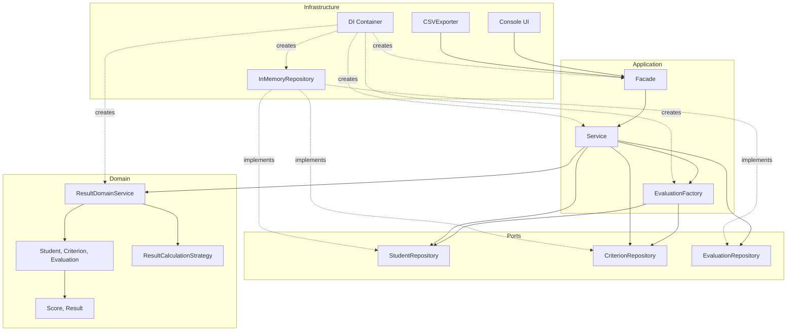

# ПОС — Преподавательская Оценка Студентов

Консольное приложение для управления оцениванием студентов по заданным критериям. Позволяет создавать студентов и критерии оценивания, выставлять и изменять оценки, рассчитывать итоговый результат и экспортировать отчёты в CSV.

## 1. Основные возможности

- Создание и просмотр списка студентов.
- Создание и просмотр критериев оценивания.
- Выставление оценок студентам по существующим критериям.
- Проверка корректности оценок относительно максимального балла критерия.
- Просмотр отчёта по конкретному студенту.
- Изменение выставленных оценок и комментариев.
- Удаление оценок.
- Расчёт итогового результата студента.
- Экспорт результатов оценивания в CSV.

## 2. Используемые технологии

- **Go** — основной язык программирования.
- **encoding/csv** — формирование CSV-файлов.
- **bufio** — обработка пользовательского ввода.
- **testing** — модульное и интеграционное тестирование.

В качестве хранилища используется реализация репозитория в оперативной памяти (`InMemoryRepository`).

## 3. Архитектура проекта

В проекте используется подход Ports & Adapters (Hexagonal Architecture), сочетающийся с принципами Onion Architecture и Clean Architecture.

Основная идея заключается в разделении бизнес-логики, прикладных сценариев и технических деталей реализации. Доменный слой не зависит от инфраструктуры, а взаимодействие между слоями организовано через интерфейсы.

### Структура проекта

```text
HW2/
├── cmd/
│   └── pos/
│       └── main.go
├── internal/
│   ├── domain/
│   │   ├── student.go
│   │   ├── criterion.go
│   │   ├── score.go
│   │   ├── evaluation.go
│   │   ├── result.go
│   │   └── result_calculator.go
│   ├── application/
│   │   ├── service.go
│   │   ├── facade.go
│   │   └── evaluation_factory.go
│   ├── ports/
│   │   ├── student_repository.go
│   │   ├── criterion_repository.go
│   │   ├── evaluation_repository.go
│   │   └── errors.go
│   └── infrastructure/
│       ├── persistence/
│       │   └── memory.go
│       ├── console/
│       │   └── console.go
│       ├── export/
│       │   └── csv.go
│       └── container/
│           └── container.go
├── go.mod
└── README.md
```

### Назначение слоёв

**Domain (`internal/domain`)**

Содержит основную бизнес-логику приложения:

- `Student` — студент.
- `Criterion` — критерий оценивания с максимальным баллом и весом.
- `Score` — объект-значение, представляющий оценку.
- `Evaluation` — оценка конкретного студента по определённому критерию.
- `Result` — итоговый результат студента.
- `ResultDomainService` — доменный сервис расчёта итогового результата.

Доменный слой отвечает за соблюдение бизнес-правил и инвариантов. Например, оценка не может быть отрицательной или превышать максимальный балл соответствующего критерия.

**Application (`internal/application`)**

Реализует прикладные сценарии использования:

- создание студентов, критериев и оценок;
- получение информации;
- изменение и удаление оценок;
- расчёт итоговых результатов;
- формирование отчётов.

`Service` координирует выполнение операций, а `Facade` предоставляет удобный интерфейс для взаимодействия с прикладным слоем.

**Ports (`internal/ports`)**

Содержит интерфейсы репозиториев, определяющие контракты взаимодействия с хранилищем данных.

Это позволяет менять реализацию хранения, не затрагивая бизнес-логику.

**Infrastructure (`internal/infrastructure`)**

Содержит технические реализации:

- `persistence` — хранение данных в оперативной памяти;
- `console` — консольный пользовательский интерфейс;
- `export` — экспорт отчётов в CSV;
- `container` — создание и связывание зависимостей приложения.

## 4. Принципы DDD

При проектировании приложения использованы следующие элементы Domain-Driven Design.

### Ubiquitous Language

В коде используются понятия предметной области: `Student`, `Criterion`, `Evaluation`, `Score`, `Result`. Это позволяет связать реализацию с терминологией задачи оценивания студентов.

### Entity и Value Object

В качестве сущностей (Entity) используются:

- `Student`;
- `Criterion`;
- `Evaluation`.

Они имеют идентификаторы и представляют самостоятельные объекты предметной области.

В качестве объекта-значения (Value Object) используется `Score`, который инкапсулирует числовое значение оценки и проверяет его допустимость.

### Инварианты

Бизнес-правила проверяются на уровне доменной модели:

- идентификаторы и обязательные текстовые поля не должны быть пустыми;
- максимальный балл критерия и его вес должны быть положительными;
- оценка не может быть отрицательной;
- оценка не может превышать максимальный балл критерия;
- оценка должна относиться к существующим студенту и критерию.

### Repository

Для работы с данными определены интерфейсы `StudentRepository`, `CriterionRepository` и `EvaluationRepository`.

Их реализация `InMemoryRepository` находится в инфраструктурном слое.

### Domain Service

`ResultDomainService` отвечает за расчёт итогового результата. Вычисление вынесено из сущностей, поскольку требует обработки нескольких оценок и соответствующих критериев.

## 5. Используемые GoF-паттерны

В проекте реализованы паттерны из трёх групп.

| Группа | Паттерн | Реализация |
|---|---|---|
| Порождающий | Factory | `EvaluationFactory` |
| Структурный | Facade | `Facade` |
| Поведенческий | Strategy | `ResultCalculationStrategy` |

### Factory

`EvaluationFactory` отвечает за создание объекта `Evaluation`. Для этого фабрика получает необходимые данные из репозиториев, формирует объект `Score` и вызывает доменный конструктор оценки.

Таким образом, логика получения зависимых объектов и создания оценки сосредоточена в одном месте.

### Facade

`Facade` предоставляет единый интерфейс для взаимодействия с прикладным слоем. Консольный интерфейс и модуль экспорта обращаются к фасаду, не взаимодействуя напрямую с отдельными внутренними компонентами приложения.

### Strategy

Для расчёта итогового результата используется интерфейс `ResultCalculationStrategy`.

Текущая реализация — `WeightedAverageStrategy`. Благодаря интерфейсу алгоритм расчёта можно заменить или расширить без изменения доменного сервиса.


### Схема зависимостей


Зависимости между слоями направлены от внешних компонентов к внутренним. Инфраструктурный слой использует прикладной слой, который, в свою очередь, обращается к доменной логике и интерфейсам портов.

Интерфейсы репозиториев определены в пакете `ports`, а их конкретная реализация находится в инфраструктурном слое. Таким образом, доменная и прикладная логика не зависят от конкретного способа хранения данных.

DI-контейнер (`container`) выступает точкой сборки приложения: он создаёт необходимые компоненты и связывает их зависимости.

## 6. Расчёт итогового результата

Для расчёта используется взвешенное среднее значение оценок.

Обозначения:

- \(s_i\) — полученный балл по критерию;
- \(m_i\) — максимальный балл по критерию;
- \(w_i\) — вес критерия.

Итоговый результат рассчитывается по формуле:

\[
R = 10 \cdot
\frac{\sum_{i=1}^{n} \frac{s_i}{m_i} \cdot w_i}
{\sum_{i=1}^{n} w_i}
\]

Результат находится в диапазоне от 0 до 10.

Критерии, по которым студент ещё не получил оценку, не участвуют в расчёте. Если у студента отсутствуют оценки, расчёт итогового результата не выполняется.

## 7. Запуск приложения

Для запуска необходим установленный Go.

Клонируйте репозиторий или откройте папку проекта, затем выполните:

```bash
go run ./cmd/pos
```

После запуска откроется консольное меню приложения.

## 8. Тестирование

Для запуска всех тестов выполните:

```bash
go test ./...
```

Тесты покрывают основные компоненты приложения:

- доменные сущности и объекты-значения;
- проверку бизнес-правил;
- расчёт итогового результата;
- прикладные сценарии;
- работу репозитория;
- экспорт отчётов в CSV.

## 9. Ограничения текущей реализации

- Данные хранятся в оперативной памяти и не сохраняются между запусками приложения.
- Взаимодействие с пользователем осуществляется через консоль.
- Для экспорта результатов используется формат CSV.

Текущая реализация ориентирована на демонстрацию архитектурных принципов, бизнес-логики и паттернов проектирования в рамках учебного проекта.

## 10. Использование ИИ

В процессе выполнения проекта ИИ использовался в качестве вспомогательного инструмента для обсуждения архитектурных решений, уточнения особенностей языка Go и поиска возможных способов реализации отдельных компонентов.

Также он применялся при разборе ошибок и подготовке тестов. Предложенные решения анализировались, адаптировались и проверялись в ходе разработки проекта.

Основные архитектурные решения и итоговая реализация формировались с учётом требований задания.